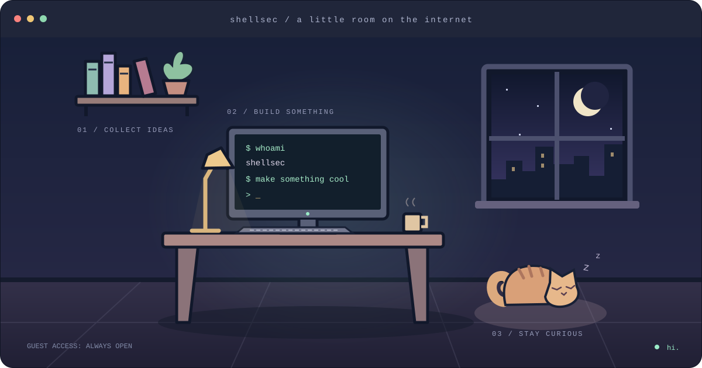

<div align="center">

<!-- A little room on the internet. Come in, look around. -->

# hey, I'm shellsec.

**一间小小的数字工作室，欢迎随便逛逛。**

Build things. Break things. Stay curious.

[](https://github.com/shellsec?tab=repositories)

**选择一个入口，开始探索。**

[ ` 🖥️ 终端 · 项目 ` ](https://github.com/shellsec?tab=repositories)　
[ ` 📚 书架 · 收藏 ` ](https://github.com/shellsec?tab=stars)　
[ ` 🐈 小猫 · 随便逛逛 ` ](https://github.com/explore)

</div>

---

```sh
guest@studio:~$ cat welcome.txt

这里是 shellsec 的 GitHub 小屋。
代码放在终端里，灵感收进书架，猫负责陪你发呆。
没有固定的参观路线，挑一个感兴趣的项目开始就好。

guest@studio:~$ ls
projects/     bookmarks/     side-quests/
```

<table>
<tr>
<td width="50%" valign="top">

### 🖥️ 打开终端

每个仓库，都是一个正在展开的故事。

[浏览我的项目 →](https://github.com/shellsec?tab=repositories)

</td>
<td width="50%" valign="top">

### 📚 翻翻书架

沿着收藏，偶遇下一个有趣的点子。

[看看我的 Stars →](https://github.com/shellsec?tab=stars)

</td>
</tr>
</table>

<details>
<summary>🐾 猫咪脚边有张纸条……</summary>

```text
       /\_/\
      ( o.o )   你发现了这间屋子的隐藏住客。
       > ^ <

      今日支线任务：
      找一个让你好奇的开源项目，读一读它的 README。
      如果喜欢，给作者留一颗星。
```

[领取支线任务 →](https://github.com/explore)

</details>

<div align="center">

<sub>这间小屋的灯一直亮着。<br/>Made of code, curiosity & a little cat hair.</sub>

</div>
