<div align="center">

# SHELLSEC / Orbital station

**代码是信号，好奇心是引力。**

[](https://shellsec.github.io/shellsec/)

[ **进入交互控制中心 ↗** ](https://shellsec.github.io/shellsec/)　·　[项目舱](https://github.com/shellsec?tab=repositories)　·　[灵感档案](https://github.com/shellsec?tab=stars)

<sub>每颗星对应一天的真实贡献 · 星越亮，贡献越多 · 每天自动同步</sub>

</div>

### 项目通讯

| 项目 | 信号内容 | 语言 | Stars |
| :-- | :-- | :-- | --: |
| [AINav](https://github.com/shellsec/AINav) | 🧭 AINav — 最全 AI 工具导航站，收录 590+ AI 工具，涵盖写作、绘图、编程、视频、音频、智能体、RAG、MCP 等分类，支持收藏、搜索、深浅主题切换。 | HTML | 4 |
| [bolemusic](https://github.com/shellsec/bolemusic) | 波乐音乐NS  Nintendo Switch 音乐播放器，支持触屏、歌词、动态氛围与多主题。音源需自行导入，支持多源自动切换。 | — | 1 |
| [LangSrcCurise](https://github.com/shellsec/LangSrcCurise) | LangSrc资产监控系统是一套实现对指定域名进行持续性信息收集整理的自动化资产监控管理系统 | Python | 54 |
| [softgitup](https://github.com/shellsec/softgitup) | SoftGitUp is a cross-platform software synchronization tool built on the principles of information security and data leakage prevention to minimize data uploads.SoftGitUp 是一个跨平台的软件同步工具，基于信息安全与数据防泄漏原则构建减少数据上传 | Python | 16 |
| [SECDaily](https://github.com/shellsec/SECDaily) | 安全资讯 RSS 日报：聚合、Markdown/HTML 归档、GitHub Pages 搜索；可选 AI 每日总结（需配置 API）Security RSS digest: multi-source aggregation, AI/keyword summaries, HTML archive, multi-channel push, and GitHub Pages search. | HTML | 4 |
| [watchvuln3](https://github.com/shellsec/watchvuln3) | WatchVuln 从 AVD、长亭、奇安信、OSCS、微步、Seebug、KEV 等源采集高危漏洞，按策略过滤后推送到钉钉、企业微信等；支持多群同类型推送、关闭启动通知、本地 Web 看板浏览情报库一键复制分析提示词并跳转 ChatGPT / Gemini / DeepSeek | Go | 3 |

<details>
<summary>▸ 解密机械猫的私人频道</summary>

```text
 /\_/\      呼号：MISO
[ o.o ]     职责：在轨巡逻、守护终端、偶尔摸鱼。
 > ^ <      发现未知信号？点开一个仓库看看。
```

在[控制中心](https://shellsec.github.io/shellsec/)里点击机械猫，接收它的留言。
终端支持 `help`、`projects`、`stars`、`warp` 和 `meow`。

</details>

<div align="center"><sub>保持好奇，继续发射。 · Built by shellsec</sub></div>
